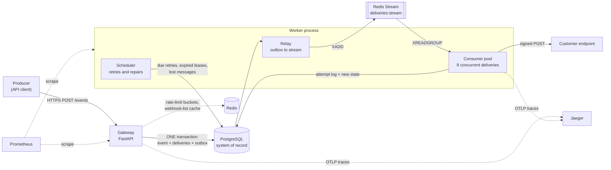
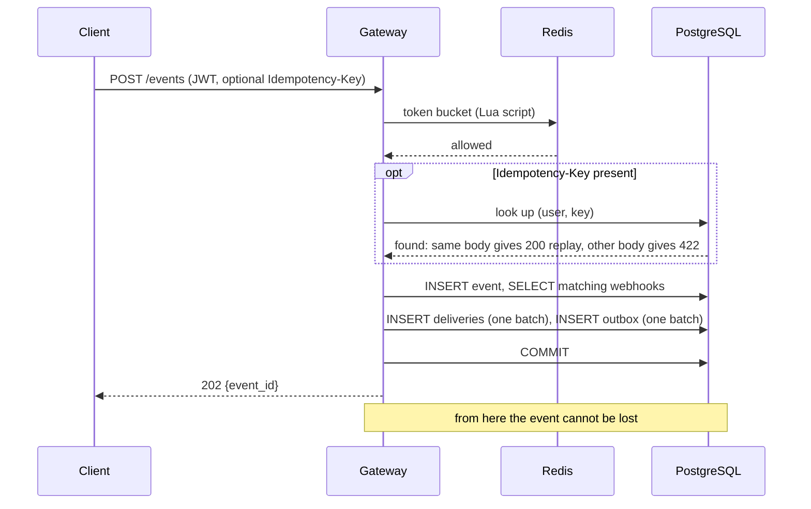
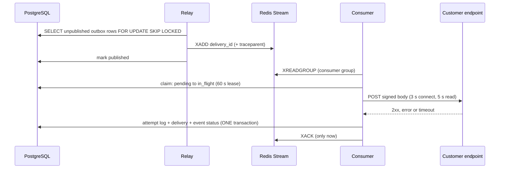
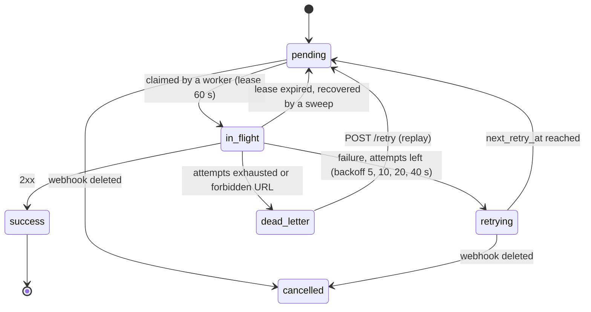

# Architecture

Ferrum is a **webhook relay**. A producer sends an event to the API; Ferrum delivers it, signed, to every endpoint the producer registered for that event type,
retries failures with exponential backoff, dead-letters what cannot be delivered, and keeps a queryable delivery log that supports replay.

## Words used in these docs

| Word | Plain meaning |
|---|---|
| **Event** | one "something happened" message a producer sends in |
| **Webhook** | a receiver's address plus the kind of events it wants |
| **Delivery** | one event going to one webhook; it has its own status and retries |
| **Outbox** | a to-do list stored in the same database transaction as the event, so "save it" and "send it later" can never disagree |
| **Relay** | the loop that moves outbox items into the queue |
| **Queue (Redis Stream)** | the waiting line of deliveries; a delivery stays on it until a worker confirms it is done |
| **Claim / lease** | a worker marks a delivery "mine" for 60 seconds so two workers never send the same one at once |
| **Dead letter** | a delivery that failed every attempt; parked so it can be re-sent by hand |
| **Replay** | re-sending failed deliveries on request |
| **Idempotency key** | a label on a request so sending it twice still counts once |

## System overview

Redis is **disposable**: if it is empty, restarted or unreachable, ingest still succeeds and the worker rebuilds the queue from Postgres.

## Guarantees

| Guarantee | Mechanism | Evidence |
|---|---|---|
| An acknowledged event is never lost | event, deliveries and an outbox row commit in one Postgres transaction before `202` | automated tests: atomic ingest; outbox rows published exactly once under 6 concurrent relays on Postgres |
| At-least-once delivery | Redis Streams consumer group; acknowledge only after the result is committed; reclaim of dead consumers; DB leases | crash-recovery tests with real Redis and Postgres; one observed `kill -9` recovery ([02](engineering/02-delivery-pipeline.md)) |
| Effectively-once at the receiver | stable `webhook-id` on every attempt (receivers dedupe); `Idempotency-Key` on ingest | smoke test, idempotency tests |
| Authentic payloads | HMAC-SHA256 per [Standard Webhooks](https://www.standardwebhooks.com/); fresh timestamp each attempt | signature verified by a real receiver in the smoke test |
| Tenant isolation | JWT identity; every query filtered by `user_id`; foreign ids answer `404` | tests over every endpoint, smoke test |
| Bounded abuse | token buckets (per user, per IP on auth), payload cap, Argon2 concurrency cap, SSRF guard | tests, load runs |
| Graceful under overload | pool timeout answers `503 Retry-After`; no pool/thread deadlock | Postgres regression tests, [05](engineering/05-connection-pool-deadlock.md) |
| Debuggable | one OpenTelemetry trace per event across every retry; `trace_id` in logs; Prometheus metrics | [08](engineering/08-tracing.md) |

Not guaranteed: ordering across retries; exactly-once to a receiver that does not dedupe; survival of a Postgres disk loss (single instance, no backup automation).

## The write path: `POST /events`

- A concurrent duplicate `Idempotency-Key` loses the `UNIQUE (user_id, idempotency_key)` race, rolls back, re-reads the winner and answers as a replay.
- Apart from the rate limiter (which fails open), ingest does not touch Redis.
- Typical ingest is **5 SQL round trips** whatever the number of matching webhooks (the previous implementation needed 6 for one webhook and 44 for twenty).

## The delivery path

Retries never sleep. A failed delivery is parked with a due time; the scheduler moves due deliveries back into this same path through the outbox:

The crash-by-crash analysis is in [engineering/02](engineering/02-delivery-pipeline.md).

## Process model

### Gateway
- uvicorn; FastAPI **sync** endpoints on the thread pool (40 threads); SQLAlchemy pool 10 + 10 overflow, `pool_timeout` 5 s.
- Every sync route is registered through `SessionReleasingRoute`, which closes the request's DB session **inside the handler's thread**. Releasing at dependency teardown instead deadlocks the pools under load ([05](engineering/05-connection-pool-deadlock.md)).
- Pool exhaustion answers `503 Retry-After: 1` instead of hanging.
- Startup fails fast without a valid `JWT_SECRET`; it does not connect to the database, so `/readyz` can report a database problem instead of crash-looping.
- `SIGTERM`: stop accepting, drain in-flight requests (≤ 20 s), close Redis and the engine.

### Worker
`python -m worker.main` runs four loops:

| Thread | Job | Liveness heartbeat |
|---|---|---|
| main | `XREADGROUP`/`XAUTOCLAIM` → pool of 8 delivery threads | `consumer` |
| `relay` | outbox → stream every 0.2 s (drains full batches immediately) | `relay` |
| `scheduler` | due retries, expired leases, stale pending deliveries every second; purge of old outbox rows every 5 min | `scheduler` |
| `health` | `:8001` `/metrics`, `/healthz`, `/readyz` | n/a |

`SIGTERM` makes the consumer finish and acknowledge its in-flight batch, then every loop exits (about 1 s when idle).

## Data stores

| Store | Holds | If it is lost |
|---|---|---|
| PostgreSQL | everything that matters ([data model](data-model.md)) | data loss (no replication or backup is configured) |
| Redis | in-flight stream messages, dead-letter copies, cache, rate-limit state | pending work is re-enqueued from Postgres: expired leases within about a minute, long-pending deliveries within `STALE_PENDING_SECONDS` (default 15 min) |

## Repository map

| Path | Contents |
|---|---|
| `ferrum-webhook-gateway/app/main.py` | routes, middleware, lifespan, `SessionReleasingRoute` |
| `…/app/crud/` | DB access; `event.create_event` is the transactional heart of ingest |
| `…/app/{security,ssrf,ratelimit,tracing,deps,db}.py` | JWT/Argon2, SSRF guard, token buckets, OpenTelemetry, dependencies, engine |
| `…/alembic/versions/` | migrations (the gateway owns the schema) |
| `ferrum-webhook-worker/worker/` | `main`, `consumer`, `delivery`, `relay`, `scheduler`, `signing`, `health`, `config` |
| `infra/local/` | one-command local stack |
| `infra/bench/` | benchmark scripts behind the numbers in [engineering](engineering/) |
| `infra/k8s/`, `infra/charts/ferrum/` | Kubernetes manifests and Helm chart |
| `infra/tests/` | smoke test, echo receiver, sink, k6 load script |

## Known limitations

1. `models.py`, `ssrf.py` and `tracing.py` exist in both services and must be kept identical (a shared package is the proper fix).
2. Webhook signing secrets are stored in plaintext in Postgres (the worker needs them in clear); envelope encryption with a KMS is the usual answer.
3. One Postgres and one Redis, no automated backups, no TLS between components, Redis without authentication.
4. Stream entries are deleted on acknowledgement, so the stream is not a replay log; replay comes from the database.
5. No per-endpoint circuit breaker: one slow receiver can delay the others in its batch by up to the read timeout (5 s).
6. JWT uses a shared HS256 secret with no revocation.
