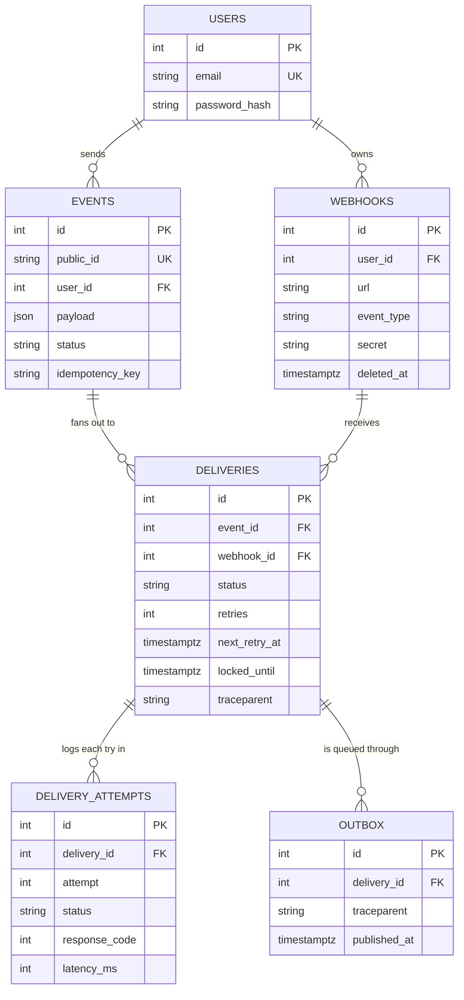
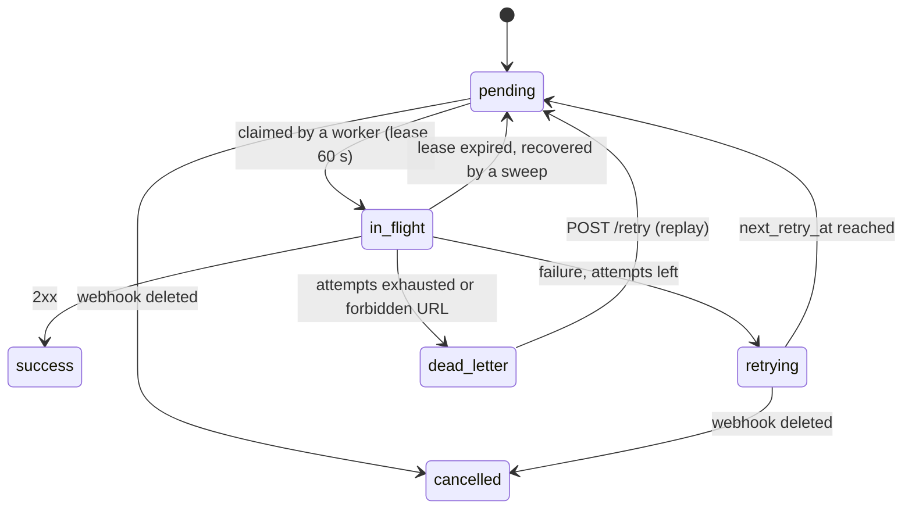

# Data Model

PostgreSQL is the system of record. The schema is owned by the **gateway** (`ferrum-webhook-gateway/app/models.py`,
migrations in `alembic/versions/`). The worker keeps an identical copy of `models.py`.

## 1. Entity relationships

A **delivery** is one (event, webhook) pair: "send this event to that endpoint". An event with 3 matching
webhooks has 3 deliveries; each has its own retry schedule, status and attempt history.

## 2. Tables

### users
| Column | Type | Notes |
|---|---|---|
| id | int PK | |
| email | text, unique | login identity |
| password_hash | text | Argon2id (m=19456 KiB, t=2, p=1) |

### webhooks
| Column | Type | Notes |
|---|---|---|
| id | int PK | |
| user_id | int FK users, indexed | owner; every query filters on it |
| url | text | validated by the SSRF guard on create/update and again before each send |
| event_type | text | exact-match routing key |
| secret | text | `whsec_` + base64(32 random bytes); Standard Webhooks signing key |
| deleted_at | timestamptz null | soft delete: deliveries keep referencing the row |

### events
| Column | Type | Notes |
|---|---|---|
| id | int PK | internal only |
| public_id | text, unique | `evt_` + 32 hex; the external id; sent as `webhook-id` |
| user_id | int FK, indexed | |
| payload | json | the producer's body |
| status | text, indexed | see state machine below |
| event_type | text, indexed | |
| idempotency_key | text null | `UNIQUE (user_id, idempotency_key)` (NULLs never conflict) |
| created_at | timestamptz | |

### deliveries
| Column | Type | Notes |
|---|---|---|
| id | int PK | |
| event_id, webhook_id | FK | `UNIQUE (event_id, webhook_id)` |
| status | text | see state machine |
| retries | int | number of attempts made so far (attempt number = retries after the attempt) |
| latency_ms, response_code, error_message | | outcome of the **latest** attempt |
| attempted_at | timestamptz | latest attempt |
| next_retry_at | timestamptz null | when a `retrying` delivery becomes due; index `(status, next_retry_at)` |
| locked_until | timestamptz null | lease on an `in_flight` delivery |
| moved_to_dlq | int | 1 once dead-lettered |
| traceparent | text null | W3C trace context of the creating/replaying request |

### delivery_attempts (the delivery log)
`id, delivery_id FK, attempt, status (success|failed), response_code, latency_ms, error_message, attempted_at`.
One row per HTTP attempt. This is what `GET /deliveries/{event_id}` returns under `attempts`.

### outbox
| Column | Type | Notes |
|---|---|---|
| id | int PK | relay order |
| delivery_id | FK | the work item to publish |
| request_id, traceparent | text null | propagated into the stream message |
| created_at | timestamptz | |
| published_at | timestamptz null | NULL = not yet on the stream; index `(published_at, id)` |

Published rows are purged after 24 h (`OUTBOX_RETENTION_SECONDS`).

## 3. State machines

### delivery.status

| Status | Meaning | Who moves it |
|---|---|---|
| `pending` | Waiting for a worker (an outbox row exists / is on the stream) | gateway (create/replay), scheduler (retry due) |
| `in_flight` | A worker holds a lease (`locked_until`) | worker claim |
| `success` | Receiver returned 2xx | worker |
| `retrying` | Failed; parked until `next_retry_at` | worker |
| `dead_letter` | Gave up (5 attempts, or forbidden target) | worker |
| `cancelled` | Webhook was deleted before delivery finished | gateway/worker |

### event.status (derived from its deliveries, recomputed under a row lock)
`pending` (just created) → `processing` (any delivery non-terminal) → `delivered` (all success/cancelled) or
`failed` (any dead_letter once all are terminal). `no_subscribers` if no webhook matched at ingest.

## 4. Migrations

| Revision | What |
|---|---|
| `82c32ae3dc4c` | Initial schema (users, webhooks, events, deliveries) |
| `0f453657c9d3` | Retry metadata (`error_message`, `moved_to_dlq`), tz-aware timestamps, indexes |
| `3b7c1d9e5a42` | Streams/outbox rework: `webhooks.secret/deleted_at`, `events.public_id/idempotency_key`, `delivery_attempts`, `outbox`, one-delivery-per-(event,webhook) |
| `5d9e3f7a2c84` | `traceparent` on deliveries and outbox |

Rules:
- CI applies `upgrade head`, `downgrade base`, `upgrade head` against a real Postgres on every push, so every migration is reversible.
- Run **once per release**, before rolling out new pods: `python -m alembic upgrade head` (Kubernetes Job `migrate` or the Helm hook). Never in the app container's start command.
- Migration `3b7c…` collapses legacy per-attempt `deliveries` rows to the latest per (event, webhook) and backfills `public_id`/`secret`. Pre-migration attempt history is dropped.
- Backward compatibility window: the previous app version cannot run against the new schema (the outbox is mandatory). Roll forward; the old gateway/worker image is not compatible.
- Create a migration: `cd ferrum-webhook-gateway && python -m alembic revision -m "..."` (write the SQL by hand; autogenerate misses constraints/data). Mirror `models.py` into the worker.

## 5. Indexes and why
| Index | Serves |
|---|---|
| `events(public_id)` unique | every `/events/{id}`, `/deliveries/{id}`, replay lookup |
| `events(user_id, idempotency_key)` unique | idempotent ingest, race resolution |
| `deliveries(event_id)`, `(event_id, webhook_id)` unique | delivery log, fan-out uniqueness |
| `deliveries(status, next_retry_at)` | scheduler's "due retries" sweep |
| `outbox(published_at, id)` | relay's "oldest unpublished" scan |
| `webhooks(user_id)`, `events(user_id)` | tenant-scoped listing |
