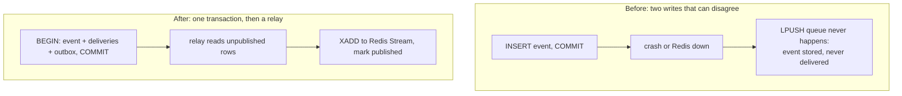

# Never lose an accepted event: the transactional outbox

*The promise a webhook platform makes is simple: if you got a `202`, we will deliver it. The first version of Ferrum could not keep that promise,
and the failure was invisible in every test that did not kill a process at exactly the wrong moment. This post is about the bug, the fix, and an experiment that tries to break the fix.*

> **In short:** Saving an event and putting it in the delivery queue used to be two separate steps, and a crash between them lost the event. Now both are saved together in one step, so either both happen or neither does.

## The bug

The original ingest path looked like this (simplified):

```python
event = crud.create_event(db, ...)      # INSERT + COMMIT  → the event is now durable
redis.lpush("event_queue", event.id)    # then tell the worker about it
return {"event_id": event.id}
```

It looks fine, and it has a window between the two lines. If the process dies, or Redis is unreachable, right there, the event exists in Postgres but no worker will ever hear about it.
Worse, the handler *swallowed* Redis errors (it logged a warning and returned success), so the client received `200` for an event that would never be delivered.
This is the **dual-write problem**: two systems (database and queue) must agree, and no ordering of the two writes makes them atomic.

| If you write… | …and crash between the writes | Result |
|---|---|---|
| database, then queue | event stored, never queued | **lost delivery** (silent) |
| queue, then database | event queued, row missing | worker fails on an event that doesn't exist; client may have seen an error for an event that *is* delivered |



## The fix: write the intent in the same transaction

The classic answer is the **transactional outbox**. Instead of publishing to the queue, the request records *the intention to publish* in the same database transaction as the business data:

```
BEGIN
  INSERT INTO events     (...)
  INSERT INTO deliveries (...)     -- one per matching webhook
  INSERT INTO outbox     (...)     -- one per delivery: "publish this"
COMMIT                              ← the event and its pending work exist together, or not at all
```

A separate **relay** loop (a thread in each worker) reads unpublished outbox rows, appends them to the Redis Stream, and marks them published:

```sql
SELECT … FROM outbox WHERE published_at IS NULL ORDER BY id LIMIT 200 FOR UPDATE SKIP LOCKED;
-- XADD each to deliveries:stream, then:
UPDATE outbox SET published_at = now() WHERE id IN (…);
```

What this buys:

- **Atomicity where it matters.** The `202` is returned after the commit; a crash before it means the client got no `202` and retries (with an `Idempotency-Key`, harmlessly); a crash after it means the work is durable and the relay will find it.
- **Redis becomes disposable.** It is a transport, not a source of truth. If it is empty, restarted or unreachable, ingest still succeeds and the outbox simply accumulates until Redis returns.
- **Scale-out for free.** `FOR UPDATE SKIP LOCKED` lets any number of relays run at once without publishing a row twice (tested with six concurrent relays on a real Postgres).

What it costs, honestly:

- **A hop of latency**: up to the relay poll interval (0.2 s) before a delivery is queued.
- **Duplicate messages are possible**: the relay publishes, then marks; a crash between the two republishes the row. The delivery side makes this harmless with an atomic claim ([next post](02-delivery-pipeline.md)).
- **A table to maintain**: published rows are purged after 24 h.

### Supporting detail: idempotent ingest

A producer that gets a timeout cannot know whether its event was accepted. `Idempotency-Key` makes retrying safe:
`UNIQUE (user_id, idempotency_key)` makes a duplicate request return the original event (`200`, `Idempotent-Replayed: true`) instead of creating a second one;
reusing a key with a different body is a `422`. Two *concurrent* requests with the same key race on the unique constraint; the loser rolls back, re-reads the winner's row and answers as a replay.

### SQL round trips

An ingest is now **5 round trips regardless of how many webhooks match** (insert event, select webhooks, one batched insert of deliveries, one batched insert of outbox rows, commit).
The earlier implementation flushed once per delivery and re-read the event after commit:

| Webhooks matching the event | Before (round trips) | After |
|---:|---:|---:|
| 1 | 6 | **5** |
| 5 | 14 | **5** |
| 20 | 44 | **5** |

*Counted with a SQLAlchemy `before_cursor_execute` listener against a real Postgres, plus the `COMMIT`. "Before" is the previous implementation kept inside the script for comparison.
Raw output: `docs/data/statements/`. Command: `ferrum-webhook-gateway/.venv/bin/python infra/bench/count_statements.py`.*

## How it is verified

| Property | Test |
|---|---|
| Event, deliveries and outbox rows are created together, or not at all | `test_ingest_writes_event_deliveries_and_outbox_atomically` |
| A retry with the same `Idempotency-Key` creates nothing new | `test_idempotency_key` (also asserts a single outbox row) |
| Six relays draining one outbox on a real Postgres publish every row exactly once | `test_concurrent_relays_publish_every_row_exactly_once` |
| A crash between publish and "mark published" republishes, and the consumer absorbs the duplicate | `test_relay_crash_between_publish_and_mark_republishes` |
| A wiped Redis does not strand pending work | `test_pending_delivery_whose_stream_message_was_lost_is_reenqueued` |
| End to end, including a valid signature at a real receiver | `infra/tests/smoke.py` |

A whole-system test that randomly kills components under load would be the natural next layer; it is not part of this repository because it was never run to completion.

## Reproduce

```bash
infra/local/stack.sh up
ferrum-webhook-gateway/.venv/bin/python infra/bench/count_statements.py        # the round-trip table
```

## Lessons
1. **Any "database then queue" code path is a bug until proven otherwise.** Make the queue write part of the transaction, or derive it from the committed data.
2. **Errors you swallow become promises you break.** The original code returned success when the enqueue failed.
3. **Test the failure, not the mechanism.** The bug survived because nothing killed a process between two statements. The tests above kill the process between the two statements on purpose; that is the only way this class of bug shows up.
4. **Make duplicates cheap rather than impossible.** The design assumes duplicate messages and duplicate deliveries will happen and gives each a stable identity.
