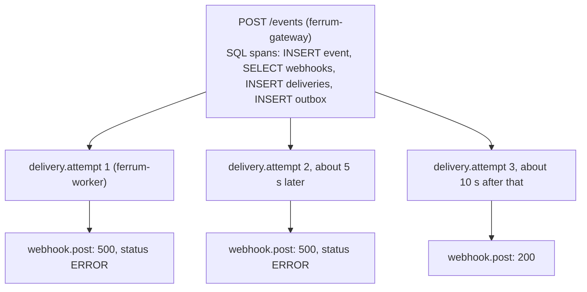

# Debugging a webhook with traces, not logs

*A webhook's life crosses an HTTP request, a database transaction, a relay, a queue, a worker, a customer's server and (often) several retries minutes apart.
Logs show each piece separately. A trace shows the whole journey as one object.*

> **In short:** A trace is one timeline of everything that happened to one event, including every retry. It costs about 3% of throughput at the default settings.

## The question tracing answers

"Customer X says event `evt_7c…` never arrived." With logs alone you grep the gateway for the request, then the worker for the event id, then correlate timestamps by hand,
and retries minutes later look unrelated. With a trace you open one page and see every hop, how long each took, which attempt failed and with what, and where the waiting happened.

## Design

One trace follows an event from ingest through **every retry and replay**. The only non-obvious part is carrying the context across two asynchronous hops (the outbox and the queue), so the trace is not cut in half.

```
POST /events (gateway)                         traceparent = current span context
   └─ INSERT delivery(traceparent), INSERT outbox(traceparent)     ← persisted in the same transaction
relay:   outbox.traceparent ──► XADD {delivery_id, traceparent}     ← copied into the stream message
worker:  delivery.attempt = child span of that traceparent          ← a retry re-uses delivery.traceparent via the outbox
```

- Context is the W3C `traceparent` string stored in two columns (`deliveries.traceparent`, `outbox.traceparent`). A **replay** re-stamps it with the replay request's context.
- Spans: FastAPI request, one per SQL statement (SQLAlchemy instrumentation), Redis commands, `delivery.attempt` (outcome, delivery id, event id) and `webhook.post` (target host, status code, ERROR on failure).
- The outbound call is a **manual** span, not auto-instrumented `requests`: auto-instrumentation would inject `traceparent` into requests to the customer, leaking internal trace ids to third parties.
- Every log line carries `trace_id`, so a log line can be pasted into the trace search.
- Export is OTLP/HTTP to Jaeger (any OTLP backend works). With no endpoint configured, spans are still created (trace ids appear in logs, context propagates) and nothing is exported.

## What a trace looks like

Schematic of one event whose receiver fails twice and then succeeds (one gateway, one worker). This is a **diagram of the span structure**, not an exported trace; real traces also contain one span per SQL statement and Redis command (a trace of an event whose receiver kept failing contained 51 spans when inspected in Jaeger).



How to read it:
- The wide gap after the first `webhook.post` is the **backoff** (about 5 s), not slowness: no span is open and no thread is occupied. The next `delivery.attempt` is a new span in the *same* trace.
- `webhook.post` carries the receiver's answer (`http.response.status_code`) and turns red for failures, so the failing attempts are visible without reading a single log line.
- Time between `POST /events` finishing and the first `delivery.attempt` starting is the **queue delay**: relay poll + stream + worker pickup.
- A `delivery.attempt` whose `outcome` is `skipped` or `busy` is a duplicate or contended message being absorbed.

## What it costs

Measured on isolated ingest (50 closed-loop clients, 4 interleaved repetitions; Jaeger in Docker as the real backend):

| Configuration (50 clients) | Runs | Throughput (req/s) | vs ratio 0 | p95 (ms) |
|---|---:|---:|---:|---:|
| tracing code present, sampler ratio 0 (nothing recorded) | 4 | 606 ± 7 |  | 99 ± 2 |
| every request recorded, no exporter | 4 | 557 ± 11 | -8% | 107 ± 4 |
| 10% sampled, exported to Jaeger *(Kubernetes/Helm default)* | 4 | 587 ± 18 | -3% | 104 ± 6 |
| 100% sampled, exported to Jaeger | 4 | 493 ± 10 | -19% | 121 ± 5 |

Because every SQL statement is a span, recording 100% of requests is not free; head sampling at 10% (the Kubernetes/Helm default) keeps the cost small while retaining enough traces to debug with.
Head sampling decides at the start of a trace, so it can drop the one failing request you wanted. **Always keeping errors and slow traces needs tail sampling** in an OpenTelemetry Collector, which is not deployed here.

An operational detail learned the hard way: at 100% sampling under load, an in-memory Jaeger (the all-in-one image) was OOM-killed repeatedly. Treat the all-in-one as a development tool.

## Using it

1. Get an id: the customer's `event_id`, the `X-Request-ID` response header, or a `trace_id` from a log line.
2. Jaeger → service `ferrum-gateway` → tag `ferrum.event_id=evt_…` (or paste the trace id).
3. Read the tree as above.

Configuration: `OTEL_EXPORTER_OTLP_ENDPOINT`, `OTEL_TRACES_SAMPLER_RATIO` ([configuration](../configuration.md#observability)).

## Tested
- `tests/test_worker.py::test_one_trace_from_ingest_through_retry`: a traceparent set at ingest travels outbox → stream → consumer; the original attempt and the scheduled retry are both children of it, and `webhook.post` records 500 then 200.
- `tests/test_webhooks_events.py::test_ingest_records_traceparent_for_the_worker`.
